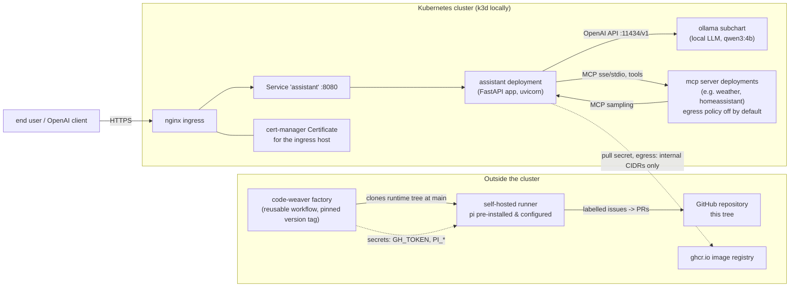

# 6. System Context

## 6.1 Technical System Context

The assistant deployment talks to exactly two kinds of neighbours inside the
cluster: the **ollama** LLM backend (its default OpenAI base URL points at the
subchart's service) and the **configured MCP servers** (over sse or stdio, for
tool loading at startup, for the periodic health probe, and — where a server
requests it — for serving the LLM back through MCP sampling). Outbound traffic
is governed by the chart's egress network policies: the assistant pod is
allowed only the internal CIDR ranges by default, and MCP server pods have
egress disabled by default.

From outside the cluster, the system touches:

* **ghcr.io** — pulling the assistant and the MCP server images (pull secret
  rendered from the `ghcrIo` values);
* **GitHub** — the CI jobs (test & lint on pull requests to `main`, image
  build & push on published releases) and the code-weaver factory;
* **the code-weaver factory** — a reusable workflow pinned to a version tag of
  `MelvinKl/code-weaver`; its job runs on a self-hosted runner that must have
  `pi` pre-installed and configured, clones the factory's runtime tree from
  `main`, and works issues labeled `code-weaver` within a 25-loop /
  2000-minute budget on the `Qwen3.8` model.

## 6.2 Actors

See chapter 2 for the actor list (end user, developer, operator, code-weaver
factory, MCP servers, subagents). From the system-context perspective the
relevant interaction points are:

| Actor | Touches the system at |
|---|---|
| End user | the ingress → service → assistant HTTP API |
| Developer | the Tilt live-reload loop, the devcontainer, the `make` targets |
| Operator | the Helm release values and the cluster itself |
| Code-weaver factory | the repository (issues, plans, pull requests) |
| MCP servers | the assistant's MCP client connections (tools in, sampling offered) |
